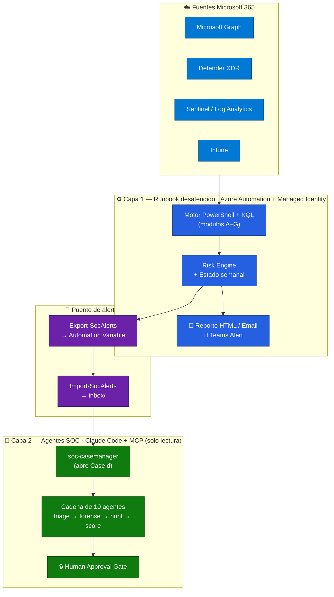
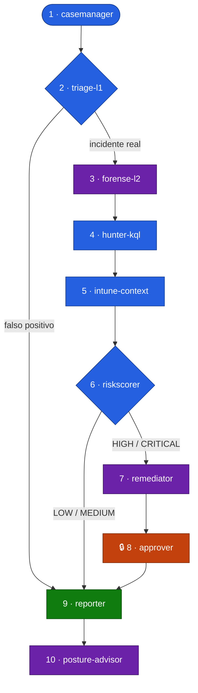
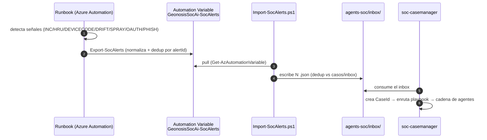
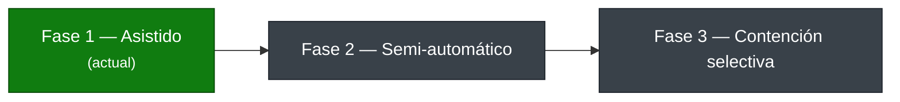

# Arquitectura — Alertas SOC AI Powered M365

> Documento de arquitectura, flujos y diseño del proyecto. Para el uso práctico ver el [README](../README.md); para el detalle técnico de despliegue, la [Documentación técnica](DOCUMENTACION.md).

---

## 💡 Idea

Un **SOC "as code"** para equipos de IT chicos y entornos **cloud-only de Microsoft 365**.

En vez de pagar un SIEM/SOAR de terceros o un SOC gestionado, la idea es **orquestar la seguridad usando solo lo que ya viene en el stack de Microsoft** — Sentinel, Defender XDR, Entra ID, Intune y Graph — sumando Azure Automation para correrlo desatendido y una capa de IA para redactar y correlacionar. Todo se entrega al canal donde el equipo ya vive: **Microsoft Teams**. Costo operativo: del orden de **centavos por mes**.

## 🎯 Misión

Que un equipo de IT reducido pueda **operar como un SOC**: ver su postura, detectar lo que realmente importa, triagear con contexto y responder con trazabilidad — **sin herramientas extra, sin un analista 24/7, y sin que la IA tome decisiones destructivas por su cuenta.**

## ✅ Objetivos

| Objetivo | Cómo lo logra |
|----------|---------------|
| **Centralizar** señales dispersas | Normaliza incidentes, riesgos, drift y hunting desde Sentinel, Defender, Entra e Intune en un formato único |
| **Reportar** postura y amenazas | Informe semanal estructurado (KPIs, incidentes, cobertura, tendencias, remediación priorizada) a email + Teams |
| **Alertar** sin ruido | Firma de estado + deduplicación: notifica solo cuando algo **cambia**, no cada corrida |
| **Enriquecer** para decidir | Motor de riesgo por entidad, correlación cross-módulo, evidencia y entidades por incidente |
| **Responder** con seguridad | Agentes que investigan y preparan remediación en **DryRun**; acciones sensibles con aprobación humana |
| **Minimizar costo** | Solo stack Microsoft + IA *metered*; sin licencias de SIEM/SOAR de terceros |
| **Trazar todo** | Cada alerta → `CaseId`; cada acción registra aprobador humano, timestamp y resultado |

## 🧭 Principios de diseño

- **Humano en el loop** — la IA resume, prioriza y propone; **no ejecuta** cambios por su cuenta.
- **Determinismo donde importa** — reglas, KQL y scoring son deterministas; la IA entra solo en narrativa y correlación.
- **Read-first, DryRun antes de actuar** — nada destructivo sin un paso previo de solo-lectura y una aprobación.
- **Mínimo privilegio** — scopes de Graph por acción, los MCP de los agentes son de **solo lectura**.
- **Sin secretos en el repo** — credenciales en variables cifradas de Azure Automation; el estado con PII nunca se versiona.

---

## 🏛️ Arquitectura: dos capas

El sistema combina una capa **desatendida** (detección/reporte programado) con una capa **interactiva** (respuesta asistida por humano). Se comunican por un puente de datos.

| | Capa 1 — Runbook | Capa 2 — Agentes |
|---|---|---|
| **Qué es** | Automatización **programada** | Investigación/respuesta **asistida por humano** |
| **Dónde corre** | Azure Automation (Managed Identity, sin keys) | Claude Code + MCP `m365-security` / `intune` |
| **Cuándo** | Semanal (lunes) + disparo crítico (horario) | Cuando salta una alerta y un humano la trabaja |
| **Rol** | Detectar, observar, reportar, deduplicar | Triagear, cazar, puntuar, preparar remediación |

---

## ⚙️ Capa 1 — Runbook desatendido

Corre en Azure Automation con **System-Assigned Managed Identity** (autentica contra Graph, Log Analytics, ARM, Defender y Azure OpenAI sin almacenar secretos). Sigue el patrón *Maester*: sin infra local, entrega a Teams + email.

**Responsabilidades:** consultar las fuentes → calcular tendencias y deltas semanales → detectar eventos críticos → generar el reporte → persistir estado para comparación y deduplicación.

**Módulos (`src/modules/`):**

| Área | Módulo | Propósito |
|---|---|---|
| A | `A-Report` | Reporte semanal, alertas críticas, narrativa IA |
| B | `B-Detection` | Incidentes, cobertura SOC, gaps de detección |
| C | `C-Observability` | Identidad, endpoints, sign-ins, password spray, attack paths |
| D | `D-ThreatIntel` | Tendencias, device-code phishing, cruce amenaza/cobertura |
| E | `E-Hygiene` | Drift de configuración, higiene de datos, posture score |
| F | `F-Engine` | Motor de riesgo y exportación de alertas normalizadas |
| G | `G-Hunting` | Hunting de phishing, OAuth, privilegios y clicks sospechosos |

**Cadencia:** reporte **completo los lunes**; el resto de los días, **disparo crítico** solo si la *firma de señales* cambió (evita renotificar lo mismo).

---

## 🤖 Capa 2 — Agentes SOC: propósito y orquestación

La capa interactiva son **10 subagentes Claude Code** (project-scoped en `.claude/agents/soc-*.md`) cableados a los MCP `m365-security` e `intune` en **modo solo lectura**. Investigan, cazan, puntúan, preparan remediación (DryRun) y documentan — **complementan, no reemplazan** al runbook.

### Propósito de cada agente

| # | Agente | Propósito | MCP / modo | Modelo |
|---|--------|-----------|-----------|--------|
| 1 | `soc-casemanager` | Abre el `CaseId`, normaliza la alerta y **enruta** al playbook correcto | solo archivos | sonnet |
| 2 | `soc-triage-l1` | Primera decisión: **¿falso positivo o incidente real?** con contexto mínimo | m365-security RO | sonnet |
| 3 | `soc-forense-l2` | Caza **persistencia**: reglas de buzón, MFA, consents OAuth, sesiones activas | m365-security RO | **opus** |
| 4 | `soc-hunter-kql` | Genera **KQL de expansión** (Sentinel/Defender) para buscar campaña / más víctimas | genera KQL | sonnet |
| 5 | `soc-intune-context` | Aporta **postura del endpoint** (compliance, cifrado, estado del device) | intune RO | sonnet |
| 6 | `soc-riskscorer` | Calcula **severidad final + confianza** con el modelo determinista de scoring | scoring local | sonnet |
| 7 | `soc-remediator` | Prepara el **plan de remediación en DryRun** (PowerShell/Graph), nunca lo ejecuta | genera DryRun | **opus** |
| 8 | `soc-approver` | **Human Approval Gate**: registra la decisión humana sobre acciones sensibles | registra decisión | **opus** |
| 9 | `soc-reporter` | Redacta el **reporte ejecutivo + técnico** separando evidencia/hipótesis/faltante | archivos | sonnet |
| 10 | `soc-posture-advisor` | Convierte **incidentes recurrentes en mejoras estructurales** del tenant | m365+intune RO | **opus** |

> Los agentes de mayor criticidad (forense, remediación, aprobación, postura) corren en **opus**; la cadena de triage/hunting/scoring/reporte en **sonnet**.

### Cadena de handoff

**Reglas de handoff:** falso positivo en triage → directo a `reporter`. Severidad **HIGH/CRITICAL** → `remediator`. Toda **acción sensible** → `approver`. Todo caso cerrado → `reporter`. Hallazgos recurrentes → `posture-advisor`.

---

## 🔗 El puente runbook ↔ agentes

Las alertas que detecta el runbook alimentan directamente a los agentes mediante una Automation Variable, sin acoplar ambas capas:

Formato de alerta: cada señal se normaliza con un `alertId` estable (clave de dedup) y se mapea a `category` + `recommendedPlaybook`. Hay **5 playbooks** operativos: BEC, password spray, device-code phishing, OAuth consent y mailbox forwarding.

---

## 🔒 Modelo de seguridad y guardrails

- `config/settings.json` y `config/crown-jewels.json` son **locales** y no se versionan.
- `agents-soc/cases/` e `inbox/` contienen evidencia *runtime* con PII → **fuera de Git**.
- Las credenciales viven como **variables cifradas** de Azure Automation.
- Las **cuentas protegidas** (break-glass, roles privilegiados, SP sensibles de `crown-jewels.json`) **nunca** reciben contención automática → siempre `pending_approval`.
- Toda remediación nace en **DryRun**; las acciones sensibles quedan `pending_approval`.
- No se almacenan ni imprimen secretos/tokens. Permisos de Graph **mínimos por acción**.
- El reporte separa siempre **evidencia confirmada / hipótesis / evidencia faltante**.

---

## 📈 Madurez (hoja de ruta)

- **Fase 1 (actual):** KQL y DryRun generados por IA, **aprobación humana**, reporte enriquecido.
- **Fase 2:** enriquecimiento/scoring automático + historial de falsos positivos.
- **Fase 3:** contención automática **solo para crítico con evidencia fuerte**; la automatización estable vive en el runbook (Azure Automation / Functions / Logic Apps), **no** en la IA interactiva.
